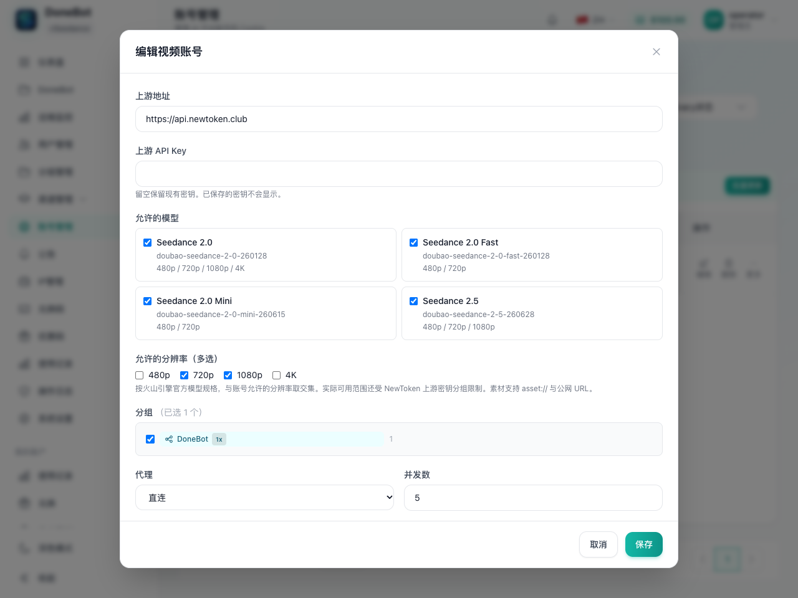
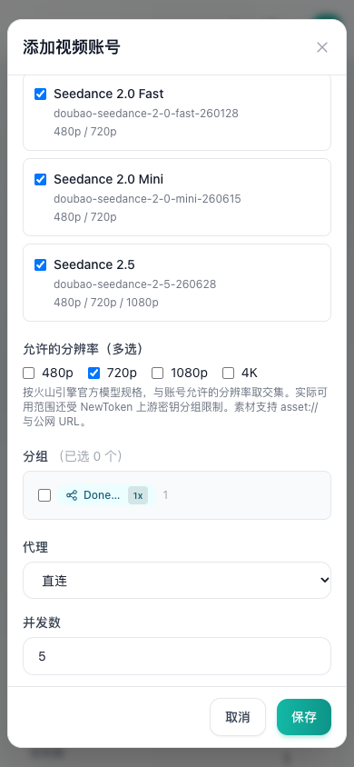

# Seedance 接入说明

核对日期：2026-11-03。本次按 NewToken 的 Seedance 官方格式接入，视频需求取代早期方案中“视频仅留开关”的范围限制；本页的参考音频属于视频请求中的素材，独立音频生成另见 [APIMart 接入说明](APIMart-接入说明.md)。

## 来源与差异

- [NewToken Seedance 官方接口](https://doc.newtoken.club/api-docs/seedance-official.html)：供应商实际承诺的模型、端点、请求与响应。
- [火山引擎创建视频生成任务](https://docs.volcengine.com/docs/ark/create-video-generation-task-api?lang=zh)：原生内容结构、素材角色与参数约束。
- [火山引擎 Seedance 2.0](https://docs.volcengine.com/docs/ark/seedance-2-0?lang=zh)、[Seedance 2.5](https://docs.volcengine.com/docs/ark/seedance-2-5?lang=zh)：各模型能力。
- [火山引擎查询视频生成任务](https://docs.volcengine.com/docs/ark/get-video-generation-task-api?lang=zh)、[取消或删除任务](https://docs.volcengine.com/docs/ark/cancel-or-delete-video-generation-tasks-api?lang=zh)：状态与任务生命周期。

分辨率按用户选择，以[火山引擎创建任务 API 的 `resolution` 字段](https://docs.volcengine.com/docs/ark/create-video-generation-task-api?lang=zh)为准。官方明确列出下表四个模型系列的分辨率集合，默认均为 `720p`；2.0 支持 `4k`，并说明其 4k 输出采用 10bit 位深和 H.265/HEVC 编码。下表的具体版本 ID 来自 NewToken，系列能力与官方逐项一致。

NewToken 页面包含一次动态修订：初始 HTML 的说明写着仅支持 720p，但页面末尾的 `DOMContentLoaded` 脚本会替换说明和价格表，展示与官方一致的分辨率矩阵，不能只解析静态正文。该脚本还说明，`doubao-官方xx全分辨率` Key 分组支持全部分辨率，其他分组受供应商限制；账号面板的选择不能扩大上游 Key 权限。

| 模型 ID | 输出分辨率 |
| --- | --- |
| `doubao-seedance-2-0-260128` | `480p`、`720p`、`1080p`、`4k` |
| `doubao-seedance-2-0-fast-260128` | `480p`、`720p` |
| `doubao-seedance-2-0-mini-260615` | `480p`、`720p` |
| `doubao-seedance-2-5-260628` | `480p`、`720p`、`1080p` |

NewToken 要求请求显式提供 `resolution`，且 `content` 至少包含一条非空文本。官方接口在部分场景允许省略文本或分辨率，不能据此放宽供应商的要求。默认值也有差异：NewToken 写明默认时长 4 秒、默认比例 `16:9`，官方部分模型默认自动时长或 `adaptive`。网关保留未提交的可选字段，避免注入一套与供应商不一致的默认值；下面示例显式填写影响结果的参数。

## 账号与开关

1. 在账号管理点击“添加视频账号”，使用视频专用面板填写名称、上游 API Key、分组、模型映射及允许的分辨率。
2. 上游 Base URL 默认为 `https://api.newtoken.club`；使用供应商原生 Bearer API Key。视频账号复用现有 OpenAI API Key 账号类型，并启用 `seedance` 端点能力。
3. 分辨率多选存放在 `credentials.seedance_allowed_resolutions`，例如 `["720p", "1080p"]`。新建面板默认勾选 `720p`。旧账号未保存该字段时不增加账号级限制，仍需满足模型与供应商 Key 的限制。
4. 可调度能力取模型支持、账号勾选及上游 Key 权限的交集。请求不满足时应拒绝，不能把请求的分辨率静默降到其他值。
5. DoneBot 模式的视频实际调用需要设置 `DONEBOT_FEATURES_VIDEO=true`；管理页的视频标签始终显示，开关关闭时仍可提前配置。视频页按模型、官方分辨率、是否含参考视频设置秒价：无参考视频按输出秒计费，有参考视频按全部输入视频总秒数 + 输出秒数计费，输入和输出使用同一有参考视频价。模型开关与售价一次保存；缺少请求对应档位的价格时在调用上游前拒绝。分组模型开关、模型映射、用户余额、安装凭据、限流和账号调度继续使用现有链路。

视频专用账号面板另有“上游产物存储方式”：默认“转发 URL”直接返回供应商地址；选择“系统存储策略”时将产物保存至 DoneBot 共享生成产物存储。该选择保存为账号 `extra.seedance_output_storage`（`upstream` / `system`），旧账号未设置时按 `upstream`。存储配置见[存储管理说明](存储管理说明.md)。

模型映射的每行包含“启用此映射”、下游模型名称、上游模型名称和官方模型规格，可新增或删除。下游名供客户端请求与 DoneBot 模型目录使用，上游名原样用于供应商请求，两者均可自定义；官方规格从上表四个型号中选择，用于分辨率、时长、参考素材及 2.5 编辑/延长能力校验，不替换上下游名称。账号允许 `1080p` 不代表 Fast 或 Mini 支持 `1080p`。

配置复用凭据 JSON：`model_mapping` 保存下游名到上游名，`seedance_model_specs` 以相同下游名关联官方规格。例如：

```json
{
  "model_mapping": {"donebot-video": "vendor-video-endpoint"},
  "seedance_model_specs": {"donebot-video": "doubao-seedance-2-5-260628"},
  "seedance_allowed_resolutions": ["720p", "1080p"]
}
```

客户端仍使用原生请求体的 `model: "donebot-video"`；网关按 Seedance 2.5 规格检查请求，发给上游时只将 `model` 换为 `vendor-video-endpoint`。关闭或删除的映射不写入两张映射表。上下游名称不能为空，不支持通配符，下游名称必须唯一；每个启用映射必须关联有效官方规格。

编辑旧账号时，优先从上游官方型号推断规格，其次从下游官方型号推断；两端都是自定义名称而未保存规格时，须手动选择后才能保存，网关不会猜测其能力。新账号默认带四个官方型号的同名映射。上游 API Key 留空保留，其他账号配置继续保留。

管理端创建、单条更新和批量更新均在写库前校验分辨率设置：仅 OpenAI API Key 类型可以保存该字段，字段必须是字符串数组，值仅允许官方枚举。合法值会去除首尾空白、转为小写并去重；显式空数组表示暂停该账号的所有分辨率创建能力。批量更新会逐个按目标账号的平台、类型以及合并后的凭据校验，任一目标不合法即拒绝整次批量写入；校验不把某个账号的密钥复制进其他账号。此行为由 `backend/internal/service/admin_seedance_account_test.go` 覆盖。

## 原生端点与素材

网关保留原生请求与响应：

```text
POST /api/v3/contents/generations/tasks
GET  /api/v3/contents/generations/tasks/{id}
```

供应商地址为 `https://api.newtoken.club/api/v3/contents/generations/tasks`。调用网关时将地址换成自己的网关域名，DoneBot 模式下 Authorization 使用安装凭据；上游 API Key 仅在账号中配置。

官方还支持同一路径的 `DELETE`，但 NewToken 页面只承诺创建和查询。透传该方法不代表供应商一定支持取消或退款，生产使用前需要单独确认。编辑与延长仍调用创建端点，通过 `omni_reference_task_type` 选择任务类型，不新增 `/edit` 或 `/extend` 接口。

图片、视频和音频分别使用以下原生结构，URL 原样传给供应商：

```json
{
  "type": "image_url",
  "image_url": {"url": "asset://ast-example"},
  "role": "reference_image"
}
```

`video_url` 对应 `{"video_url":{"url":"..."},"role":"reference_video"}`，`audio_url` 对应 `{"audio_url":{"url":"..."},"role":"reference_audio"}`。三类素材均可使用供应商素材库的 `asset://...` 或上游可访问的公网 HTTP(S) URL，且可在同一请求混用。图片也可使用原生支持的图片 Data URL。

`asset://ast-...` 是上游素材库引用，与网关 `/v1/assets` 返回的本地资产 ID 不是同一命名空间，不自动转换。网关上传的素材可以使用其可公开访问的下载 URL；不要把网关资产 ID 拼成上游 `asset://`。上游素材库引用还受到账号、区域与渠道归属限制，NewToken 提醒多渠道下优先使用公网 URL。素材创建、归属、下载权限和真实媒体参数仍由上游校验。

素材模式约束：

- 首帧：一张图片，`role=first_frame`；官方也允许该单张图片省略 `role`。
- 首尾帧：两张图片，分别标记 `first_frame` 和 `last_frame`，每种最多一张；尾帧必须配合首帧。
- 参考生视频：图片使用 `reference_image`，视频使用 `reference_video`，音频使用 `reference_audio`。
- 首帧或首尾帧模式不能与参考图片、参考视频或参考音频混用。
- 2.0 系列参考模式最多 9 张图片、3 段视频、3 段音频；音频参考还需要图片或视频。2.5 最多 30 张图片、10 段视频、10 段音频，支持仅以音频作为参考素材，但仍应提供 NewToken 要求的文本。
- 比例支持 `16:9`、`9:16`、`1:1`、`21:9`、`4:3`、`3:4`、`adaptive`。2.5 首帧和首尾帧模式按官方要求使用 `adaptive`。
- 2.0 系列固定时长为 4–15 秒；2.5 为 4–30 秒；官方还支持 `duration=-1` 自动决定时长。输入参考视频由网关读取 MP4/MOV 视频轨元数据以核实时长，单文件最多 256 MiB、元数据最多 16 MiB，全部输入读取限时 60 秒；其余媒体时长与帧率限制由上游检查。无法核实时长的格式或文件在创建前拒绝。

## 请求示例

以下 JSON 均直接作为创建接口的请求体；示例 URL、素材 ID 与任务 ID 需换成真实可用值。

### 文生视频

```json
{
  "model": "doubao-seedance-2-0-fast-260128",
  "content": [{"type": "text", "text": "清晨的海边，镜头缓缓推进，海浪拍打礁石。"}],
  "resolution": "720p",
  "ratio": "16:9",
  "duration": 6,
  "generate_audio": true,
  "watermark": false
}
```

### 首帧图生视频

```json
{
  "model": "doubao-seedance-2-5-260628",
  "content": [
    {"type": "text", "text": "人物转头看向窗外，镜头平稳向前移动。"},
    {"type": "image_url", "image_url": {"url": "asset://ast-first-frame"}, "role": "first_frame"}
  ],
  "resolution": "720p",
  "ratio": "adaptive",
  "duration": 6
}
```

### 首尾帧生视频

```json
{
  "model": "doubao-seedance-2-5-260628",
  "content": [
    {"type": "text", "text": "镜头从房间内平滑移动到阳台，衔接首尾两帧。"},
    {"type": "image_url", "image_url": {"url": "https://media.example.com/first.jpg"}, "role": "first_frame"},
    {"type": "image_url", "image_url": {"url": "asset://ast-last-frame"}, "role": "last_frame"}
  ],
  "resolution": "1080p",
  "ratio": "adaptive",
  "duration": 8
}
```

### 多模态参考生视频

```json
{
  "model": "doubao-seedance-2-5-260628",
  "content": [
    {"type": "text", "text": "使用参考图中的角色，参考视频的运镜，配合参考音频的节奏在海边奔跑。"},
    {"type": "image_url", "image_url": {"url": "asset://ast-character"}, "role": "reference_image"},
    {"type": "video_url", "video_url": {"url": "https://media.example.com/camera.mp4"}, "role": "reference_video"},
    {"type": "audio_url", "audio_url": {"url": "asset://ast-rhythm"}, "role": "reference_audio"}
  ],
  "resolution": "720p",
  "ratio": "16:9",
  "duration": 8,
  "omni_reference_task_type": "reference"
}
```

`omni_reference_task_type` 仅适用于 2.5，允许 `auto`、`reference`、`edit`、`extend`。`auto` 与 `reference` 不要求一定包含参考视频；例如仅参考图片也可使用 `reference`。2.0 系列参考生视频应省略这个 2.5 专用字段。

### 2.5 视频编辑

```json
{
  "model": "doubao-seedance-2-5-260628",
  "content": [
    {"type": "text", "text": "将参考视频的背景改成雪山，保留人物动作和镜头轨迹。"},
    {"type": "video_url", "video_url": {"url": "asset://ast-source-video"}, "role": "reference_video"},
    {"type": "image_url", "image_url": {"url": "https://media.example.com/mountain.jpg"}, "role": "reference_image"}
  ],
  "resolution": "720p",
  "ratio": "adaptive",
  "duration": -1,
  "omni_reference_task_type": "edit"
}
```

编辑必须提供参考视频，`ratio=adaptive`、`duration=-1`；被编辑视频应符合官方 4–30 秒等媒体要求。不要通过固定提示词关键词列表判断编辑意图，最终任务类型校验由上游完成。

### 2.5 视频延长

```json
{
  "model": "doubao-seedance-2-5-260628",
  "content": [
    {"type": "text", "text": "延长参考视频，人物继续向前奔跑，镜头保持相同方向。"},
    {"type": "video_url", "video_url": {"url": "https://media.example.com/source-6s.mp4"}, "role": "reference_video"}
  ],
  "resolution": "720p",
  "ratio": "adaptive",
  "duration": 12,
  "omni_reference_task_type": "extend"
}
```

延长必须提供参考视频并使用 `adaptive`。NewToken 明确说明 `duration` 是输出视频总时长，例如把 6 秒输入延长至总计 12 秒时填写 12，不能填“新增 6 秒”。官方允许 4–30 秒或 `-1`，实际与源视频的兼容性由上游检查。

2.5 的 `draft`、`draft_task` 和 `output_format` 等附加能力沿用原生字段。NewToken 的草稿示例与官方正式生成的草稿组合限制存在差异，网关保留字段，由供应商判定组合是否可用。`generate_audio`、`watermark`、`return_last_frame`、`priority`、`execution_expires_after`、`tools`、`safety_identifier` 等参数也不转换成网关自定义协议。

## 查询、归属与计费

创建成功返回供应商任务 ID，例如：

```json
{"id": "ultra720_example"}
```

使用该 `id` 查询 `/api/v3/contents/generations/tasks/ultra720_example`。查询结果可能另外包含 `doubao-id`，它是供应商内部任务 ID，不能替代创建时返回的 ID。响应中的 `model`、`status`、`content.video_url`、`usage`、时长、比例、分辨率等字段保持原生结构。

NewToken 描述的状态为 `queued`、`processing`、`succeeded`、`failed`；官方还有 `running`、`cancelled`、`expired`。轮询方应保留并识别这些原生状态。任务绑定创建凭据及上游账号，查询继续使用原账号，避免素材归属或任务 ID 在其他渠道不可见。

视频成功后按以下口径结算，复用现有分组模型价格卡、倍率、用户余额及用量日志：

- 无参考视频：计费秒数 = 实际输出秒数，使用无参考视频价。
- 有参考视频：计费秒数 = 全部输入视频总秒数 + 实际输出秒数，输入与输出均使用同一有参考视频价。多个输入视频的时长相加；图片与音频参考不计入输入视频时长。

只有状态为 `succeeded` 且包含有效 `content.video_url` 才计费。实际输出时长优先使用正数 `frames / framespersecond`，否则使用正数 `duration`；请求时长和 token 数均不替代实际产出时长。重复查询同一成功任务只记账一次；失败、取消或过期任务不按成功生成扣费。余额耗尽的创建者仍可查询自己的已创建任务。

创建前按请求输出秒数估算余额，自动时长 `duration=-1` 对输出部分保守估算 30 秒；有参考视频时还须加上全部输入视频总时长。最终用实际输出时长结算，并在有参考视频时保留输入视频总时长。视频编辑与延长也使用这一公式：把 6 秒输入延长至总计 12 秒，计费时长为 `6 + 12 = 18` 秒；输入 3 秒和 5 秒的两个参考视频并输出 10 秒时同样为 18 秒。价格严格匹配模型、分辨率和有/无参考视频档位；图片或音频参考不算参考视频，不回退到其他档位或 Grok 价格。详情见[模型定价说明](模型定价说明.md)。

输入视频时长由服务端读取公网文件的媒体元数据验证，不读取客户端自报的时长。`asset://...` 使用本次调度的上游账号调用供应商文档中的素材查询 API，取得下载 URL 后读取视频元数据；所用渠道须支持该素材 API。任一输入验证失败时，在创建上游任务前拒绝，原生素材引用仍原样传给上游。

服务器及 Docker 镜像无需安装 FFmpeg 或 ffprobe：网关直接解析 MP4/MOV 视频轨元数据。这两个工具仅用于开发时对照验证。

升级前已在途的有参考视频任务可能没有保存输入时长。此类任务暂停结算并等待核对，不将缺失时长视为 0；已经持久记账的任务仍按原去重记录识别，不重复收取费用。

异步扣费复用原计费队列，队列满时同步降级，计费失败释放任务 claim 以供后续查询重试。Seedance 不使用图片生成权限开关或图片并发池；用户并发、账号并发和安装凭据归属校验继续生效。原生 `usage` 字段保持不变，可用于供应商成本核对。

NewToken 页面按人民币/百万 token 报供应商成本，网关面向用户的本地售价按秒配置：无参考视频为输出秒，有参考视频为输入视频总秒数 + 输出秒数，两部分使用同一有参考视频秒价。后台保留原有 USD 价格标签与 `price_per_second` 字段，不新增输入价或更改已保存的秒价；运营方应自行核对现有计价币种、成本与售价。网关不硬编码汇率或网页报价，不新建报价单、预授权单或独立账本。

官方产物 URL 和任务记录有有效期，但 NewToken 未承诺完全相同的保留策略。需要长期保留的产物应在实际有效期内转存；上线前应确认供应商的保留、取消和异常任务收费政策。

## 实现文件与验证

| 文件 | 改动原因 |
| --- | --- |
| `backend/internal/service/seedance.go`、`seedance_account.go` | 原生六种模式、素材引用、官方模型约束与账号分辨率筛选 |
| `backend/internal/service/seedance_seconds_pricing.go`、`donebot_model_pricing.go` | 无参考时按实际输出秒数，有参考时加全部输入视频秒数；按模型/分辨率/参考视频档位定价 |
| `backend/internal/service/admin_account.go`、`admin_seedance_account.go` | 创建、更新和批量更新时验证分辨率配置 |
| `backend/internal/handler/grok_media.go`、`gateway_inflight_reservation.go`、`openai_gateway_handler.go` | 分辨率路由、并发槽释放、视频独立权限、秒数余额估算及不可丢弃的异步计费 |
| `backend/internal/server/middleware/api_key_auth.go` | 余额耗尽后仍允许鉴权通过的创建者查询原有任务 |
| `frontend/src/components/account/VideoAccountModal.vue`、`videoAccount.ts`、`index.ts` | 专用创建和编辑面板、可自定义上下游模型映射、官方规格与分辨率选项 |
| `frontend/src/views/admin/AccountsView.vue`、`components/admin/account/AccountTableActions.vue`、`i18n/locales/{zh,en}/admin/accounts.ts` | 添加视频账号入口、编辑分流与中英文文案 |
| 相邻 `seedance*_test.go`、`admin_seedance_account_test.go`、`*.spec.ts`、`screenshots/seedance-*` | 协议、能力筛选、鉴权、余额、计费及页面回归证据 |

账号配置保存在已有凭据 JSON 字段中，无数据库结构变更，无新增迁移或依赖升级。新增行为先用失败测试复现，再实现并转绿。

后端在 `backend/` 执行：

```sh
GOTOOLCHAIN=auto go test ./...
GOTOOLCHAIN=auto go test -tags=unit -p 1 ./...
GOTOOLCHAIN=auto go test -race -tags=unit ./internal/service ./internal/handler ./internal/server/middleware -run '^Test(Seedance|CreateVideoAccount|CreateSeedanceAccount|UpdateSeedanceAccount|BulkUpdateSeedanceAccount|ValidateSeedance)' -count=1
```

初版 Seedance 接入时以上三条后端命令均通过，覆盖原生六种模式、素材引用原样透传、官方分辨率与映射后模型校验、连续跳过多个不合格账号、并发槽释放、任务归属、余额耗尽查询、余额预留、成功任务只计一次及计费队列溢出降级。未调用真实上游产生视频费用。

前端在 `frontend/` 执行：

```sh
pnpm lint:check
pnpm typecheck
pnpm test:run
pnpm build
```

v0.4.0 前端全量 393 个文件、3116 项测试通过，包含 APIMart、逐模型定价、统一存储、视频产物策略及备份页兼容；最新模型映射与 LLM 倍率回归结果见[验收记录](验收记录.md)。lint、类型检查和构建通过。构建保留既有的大 chunk、Browserslist 和导入方式提示，未因此升级依赖。页面使用本地 API fixture 验证桌面 1280×960 和手机 390×844，页面与面板均无横向溢出；编辑时密钥输入为空，原有分辨率勾选正确。

| 桌面编辑 | 手机分辨率选项 |
| --- | --- |
|  |  |

## 人工联调

- 使用真实 NewToken Key，分别验证上面的六种输入模式以及 `asset://` / 公网 URL 混合输入；离线测试不证明供应商账号拥有这些权限。
- 确认 Key 分组支持勾选的分辨率，尤其 2.0 的 `4k`、2.5 的 `1080p`；Fast/Mini 只申请其支持的分辨率。
- 核对成功任务的实际输出时长及全部输入视频总时长；无参考按输出秒，有参考按输入总秒 + 输出秒，多个输入视频按时长求和且输入/输出使用同一有参考视频价。分别验证编辑和延长，再对照模型、分辨率、秒价、倍率与最终扣费，并单独核对供应商 token 成本；确认重复轮询只扣一次；确认余额耗尽后仍可查询自己的已创建任务。
- 如需取消，单独验证 NewToken 对 `DELETE` 的支持及其计费规则。
