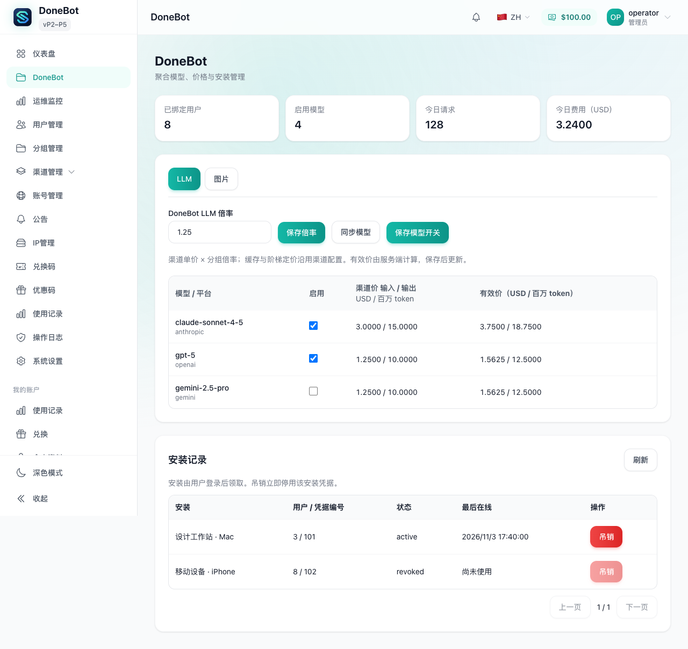
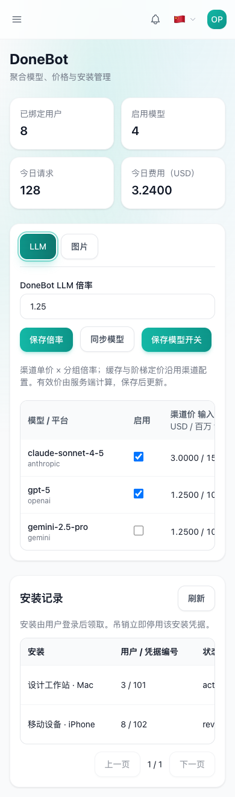
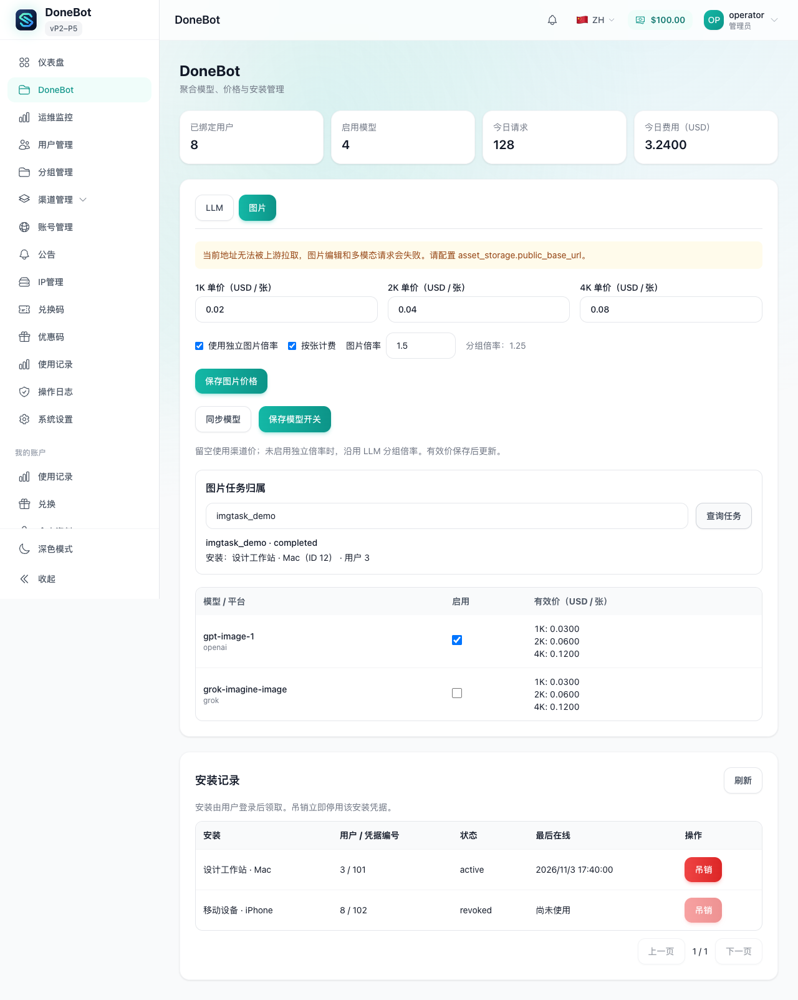
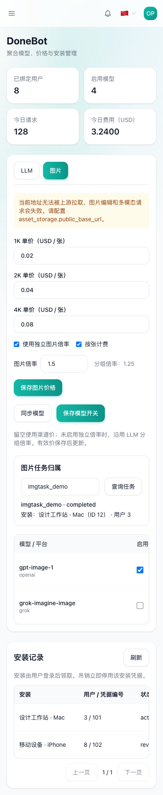

# DoneBot P2–P5 验收记录

日期：2026-11-03。范围仅为本仓库网关；未读取或修改 DoneBot 客户端。

> 本文记录最初 P2–P5 的验收范围与历史测试。后续新增的 LLM 每模型倍率、媒体售价及音频和视频管理，以[模型定价说明](模型定价说明.md)、[APIMart 接入说明](APIMart-接入说明.md)和[Seedance 接入说明](Seedance-接入说明.md)为准；下文“仅两页”“视频音频不做”均为当时范围。

## 实现与证据

| 阶段 | 已实现 | 验证 |
| --- | --- | --- |
| P2 | DoneBot 管理页仅有 LLM、图片两个标签；模型同步、开关、倍率、尺寸价格、安装吊销、图片任务所属安装查询 | service/handler/路由测试；前端组件/API 测试；1280 与 390 浏览器检查 |
| P3 | 安装凭据鉴权的资产上传/查询/删除，SHA256 全局去重、各凭据独立所有权、本地签名下载、S3 兼容存储、到期清理 | PostgreSQL 并发上传、真实本地 HTTP、模拟 S3 请求、超限/过期/越权/清理失败测试；251 迁移 down/up |
| P4 | composite 按已解析平台进入 OpenAI/Grok 异步生图，Gemini 明确拒绝；任务与产物 TTL 分离；创建前余额准入与现有预留；交付成功后提交原计费任务 | 202/轮询、凭据归属、失败不扣费并释放预留、尺寸定价、24 小时幂等、Redis 实际重启测试 |
| P5 | 契约检查、全量测试、构建、截图、部署配置与手工请求样例 | 下文命令与边界 |

模型同步取可调度能力与渠道定价的交集，保留已关闭模型，不覆盖运营方的既有选择。所有价格仍写现有分组字段，更新走 AdminService 的缓存失效链路。管理写接口复用 step-up，管理员访问密钥的权限目录及中英文标签已补齐。

资产迁移为 `backend/migrations/251_assets.sql`，回滚为 `backend/migrations/down/251_assets.sql`。`asset_owners` 用于全局去重后的凭据权限隔离；一个凭据删除自己的引用不会删除其他凭据使用的对象。清理任务启动即执行，之后每小时执行；对象删除失败保留记录重试。

异步图片沿用原 worker、余额/订阅/Key 额度与用量日志。预留由提交移交给 worker，不重复登记；上游失败、转存失败、panic、完成状态保存失败均不提交扣费。图片结果保存成功才交给原计费 worker pool。未引入报价单或新账本。

## 关键文件与原因

| 文件 | 原因 |
| --- | --- |
| `backend/internal/service/donebot_admin_service.go`、`handler/admin/donebot_handler.go`、`server/routes/donebot.go` | 管理目录、模型开关/价格、安装与任务归属接口 |
| `frontend/src/views/admin/DoneBotView.vue`、`components/admin/donebot/*`、`api/admin/donebot.ts` | 两个管理标签、表格、价格与安装/任务操作 |
| `backend/internal/service/asset_service.go`、`asset_storage.go`、`repository/asset_repo.go`、`asset_storage_local.go`、`asset_storage_s3.go` | 内容去重、所有权、签名下载、双存储与到期清理 |
| `backend/internal/handler/asset_handler.go`、`server/routes/assets.go` | 上传限制及安装鉴权的资产 HTTP 接口 |
| `backend/migrations/251_assets.sql`、`down/251_assets.sql` | 资产及所有权表、索引和可执行回滚 |
| `backend/internal/handler/image_task_handler.go`、`image_task_billing.go`、`image_task_deferred_billing.go`、`openai_gateway_handler.go` | 平台准入、创建前预留及成功交付后的计费任务提交 |
| `backend/internal/service/image_task.go`、`image_task_idempotency.go`、`repository/image_task_idempotency.go` | TTL、原子幂等与交付状态反馈 |
| `backend/internal/service/billing_inflight_reservation.go`、`handler/gateway_inflight_reservation.go` | 复用提交预留、余额续期与显式尺寸估算 |
| `backend/internal/config/*`、`service/wire.go`、`repository/wire.go`、`cmd/server/wire*`、`deploy/config.example.yaml` | 配置加载/校验、依赖装配、清理启停与部署示例 |
| `backend/internal/pkg/adminaccess/catalog*`、`frontend/src/i18n/locales/*/adminAccessKeys.ts` | 管理员权限精确授权与标签 |
| `frontend/src/router/index.ts`、`components/layout/AppSidebar.vue`、`composables/useBatchImageAccess.ts` | DoneBot 导航并停止普通 Key 的侧栏请求 |
| `backend/internal/server/routes/donebot_media_gate*`、`gateway.go` | DoneBot 视频/音频开关 |
| 各对应 `*_test.go` / `*.spec.ts`、`docs/donebot/screenshots/*` | 新能力的回归、集成及响应式页面证据 |

## 契约核对

| 契约 | 结论 |
| --- | --- |
| Anthropic / OpenAI / Gemini 原生请求响应 | 复用原路由与协议处理；未修改协议构造 |
| 安装领取与吊销 | 延用 P1；安装凭据归属真实用户，管理端不展示明文 |
| 普通用户 Key | DoneBot 模式下入口、接口及侧栏预取均关闭 |
| `/v1/models`、关闭模型的请求准入 | 延用 allowlist；已有网关测试覆盖过滤与原版 404 拒绝 |
| `/v1/assets` POST/GET/DELETE | 新增；按安装 Key 校验所有权，上传超限 413 |
| `/assets/:id?token=...` | ID 与过期时间绑定 HMAC 签名；无需安装凭据即可供上游拉取；篡改/过期 403 |
| 异步提交 | 202，`Location`、`Retry-After: 3`；`object=image.generation.task` 沿用基线 |
| 任务查询 | APIKeyID 与 UserID 同时校验；余额耗尽后仍可取回已有任务 |
| `Idempotency-Key` | 24 小时、用户与安装 Key 隔离；相同请求返回同一任务且只执行一次；不同 payload 409 `IDEMPOTENCY_KEY_CONFLICT` |
| 余额不足 | 沿用原错误：鉴权可返回 403 `INSUFFICIENT_BALANCE`；图片计费准入可返回 403 `billing_error`，不统一改写成 402 |
| 视频/音频 | 不新增页面；默认配置关闭时媒体端点拒绝访问 |

图片任务只有携带 `Idempotency-Key` 才提供幂等保护；不带 Key 的提交视为新任务，24 小时后不得复用同一个 Key。payload 包含路径、Content-Type 和请求体字节，因此重试应使用相同请求体（multipart 需保持相同边界）。网关进程重启后 Redis 任务可查询；正在运行的上游请求不会自动重放。Redis 持久化是部署前提，应用不会替运营方修改 Redis 配置。异步图片任务的创建/查询存储故障返回 503；完成状态在已返回 202 后由后台保存，保存失败会记录日志、放弃提交扣费并尝试标记失败，不能改写已经返回的 HTTP 状态。媒体结算入队也要求 Redis 可用。未完成任务与待结算队列没有独立的 PostgreSQL 副本，必须启用 AOF、持久化数据目录，并验证恢复流程。

## 测试命令

从 `backend/` 执行：

```sh
GOTOOLCHAIN=auto go test ./...
GOTOOLCHAIN=auto go test -tags=unit -p 1 ./...
GOTOOLCHAIN=auto go test -tags=integration ./internal/repository -run '^(TestDoneBot|TestAsset|TestImageTaskPersistence)' -count=1 -v
```

从 `frontend/` 执行：

```sh
pnpm lint:check
pnpm typecheck
pnpm test:run
pnpm build
```

结果：Go 全量测试通过；Docker 集成测试 11 项通过（含全新库启动、重复/并发启动、资产 down/up、Redis 实际重启）。前端 lint、typecheck、build 通过，Vitest 385 个文件 / 3069 个测试通过。构建仅有现有大 chunk 提示，未修改依赖。

额外通过 `go test -race ./internal/handler -run 'TestAsyncImageDoneBot|TestAsyncImageBilling' -count=1`，以及带 `unit` 标签的预留续期与显式尺寸估算 race 测试。首次全量检查发现的路由源级断言、权限翻译遗漏已修复。一次既有 SQL 耗时断言受并发负载影响失败，单独重跑通过，随后串行包执行的完整 unit 测试通过。

Redis 重启测试启用 AOF、`appendfsync always`，实际停止并重新启动容器后，重建 service/store，确认 processing 任务及幂等映射仍可读取。该测试验证持久化与查询，不表示进程重启后会恢复上游执行。

## 页面截图

截图来自本仓库 Vite 页面及 API fixture，未接入生产数据或真实供应商。浏览器 console 为 0 errors / 0 warnings；1280 与 390 的 document/body 均无横向溢出，宽表在自身容器滚动。

| 桌面 1280 | 手机 390 |
| --- | --- |
|  |  |
|  |  |

## 部署配置

完整字段见 `deploy/config.example.yaml`。本地驱动示例：

```yaml
donebot:
  enabled: true
  group_name: DoneBot
  auto_create_group: true
  features:
    video: false
    audio: false
asset_storage:
  driver: local
  local_path: data/assets
  public_base_url: https://gateway.example.com
  ttl_hours: 168
  max_bytes: 33554432
image_storage:
  enabled: true
  driver: local
image_task:
  ttl_hours: 24
  execution_timeout_minutes: 30
billing:
  inflight_reservation:
    enabled: true
    ttl_seconds: 3600
    fail_closed_on_unpriced: true
```

当前 DoneBot 模式支持上传与生成产物分别选择驱动；上面的 YAML 只提供尚未在后台保存策略时的兼容初始值，不要求 `image_storage.driver` 与 `asset_storage.driver` 一致。后台“DoneBot → 存储”的独立策略优先，详见[存储管理说明](存储管理说明.md)。local 异步必须配置公开绝对地址并反代 `/assets/*`；使用持久化卷保存本地资产目录。JWT secret 须稳定，轮换会使既有本地签名 URL 失效。

使用 S3/R2/OSS 时，在对应存储策略中选择 `s3` 并填写连接信息、桶与前缀；兼容 YAML 上传初始值使用 `asset_storage.driver` 和 `asset_storage.s3`，已启用且完整的旧 `image_storage` S3 配置可独立覆盖生成产物初始值。DoneBot 产物复用 AssetService，默认保留 168 小时；无公开 URL 时签名有效期受 S3 七天上限约束。切换默认驱动后，保留旧驱动的凭据和本地卷，直到原对象到期清理完成。

资产元数据与存储对象不属于同一个事务。对象写入成功后数据库失败或提交结果未知，以及 S3 Put 成功后生成签名 URL 失败，可能留下没有 `assets` 记录的对象；按数据库 TTL 清理无法发现这些对象。应用不对结果未知的写入补偿删除，避免误删并发重试使用的相同哈希对象。部署方应为专用资产桶设置保留期不短于资产 TTL 的 S3 lifecycle，或定期对账清扫；本地卷也需运维对账清扫。单个已记录对象删除失败或旧驱动不可用会保留记录并汇总错误，其他过期对象继续清理。

余额资格检查在缓存失败时回源数据库，余额源也不可用时返回 503；只有通用预留内部故障仍保留原 fail-open 兼容路径。这不代表整个异步系统会放行：媒体结算入队、图片任务持久化/查询故障返回 503；收费的异步媒体提交还要求有效预留。DoneBot 启用在途预留后以完整费用估算检查余额；`max_reservation_usd` 只是旧路径截断预留的兼容参数，不是单次消费上限，DoneBot 不使用它截断估算。余额预留可续期；订阅/Key 额度的 scope 预留沿用原 TTL，建议设为至少大于 worker 最大执行时间与计费落库时间，如上例 3600 秒。省略/自动尺寸使用原保守估算，最终仍按实际用量结算。估算准入不能替代实际账单核对，也不提供实际消费绝不超过估算的承诺。

## 手工请求样例

以下变量由部署方在本机设置，不应提交真实 token 或密钥：`GATEWAY`、`ACCESS_TOKEN`、`INSTALL_CREDENTIAL`。

```sh
# 登录后的用户领取安装；credential 仅首次返回。
curl "$GATEWAY/api/v1/donebot/installations/claim" \
  -H "Authorization: Bearer $ACCESS_TOKEN" -H 'Content-Type: application/json' \
  -d '{"installation_id":"manual-p5-device","install_name":"验收设备","fingerprint":"p5"}'

curl "$GATEWAY/v1/models" -H "Authorization: Bearer $INSTALL_CREDENTIAL"

# 原生 OpenAI 请求，无 DoneBot 包装。
curl "$GATEWAY/v1/chat/completions" \
  -H "Authorization: Bearer $INSTALL_CREDENTIAL" -H 'Content-Type: application/json' \
  -d '{"model":"<已启用文本模型>","messages":[{"role":"user","content":"hello"}],"max_tokens":32}'

# 连续上传同一文件；第二次应为 deduplicated=true。
curl "$GATEWAY/v1/assets" -H "Authorization: Bearer $INSTALL_CREDENTIAL" \
  -F 'file=@reference.png' -F 'purpose=image'

curl "$GATEWAY/v1/images/generations/async" \
  -H "Authorization: Bearer $INSTALL_CREDENTIAL" \
  -H 'Content-Type: application/json' -H 'Idempotency-Key: p5-image-001' \
  -d '{"model":"<已启用图片模型>","prompt":"a small cat","size":"1024x1024","n":1}'

curl "$GATEWAY/v1/images/tasks/<task_id>" -H "Authorization: Bearer $INSTALL_CREDENTIAL"
curl "$GATEWAY/v1/assets/<asset_id>" -H "Authorization: Bearer $INSTALL_CREDENTIAL"
curl -X DELETE "$GATEWAY/v1/assets/<asset_id>" -H "Authorization: Bearer $INSTALL_CREDENTIAL"
```

## 仍需部署方确认

- 真实 R2 或 OSS 桶、公开域名与访问策略；本次只验证本地存储和模拟 S3 协议，未使用生产凭据。
- 真实上游能匿名拉取上传 URL 并成功完成图片编辑；真实 LLM/图片账单与渠道价格一致。缺少供应商测试账号，本次未发生真实上游消费。
- 部署环境的 Redis AOF/卷、资产卷、反代超时与公开 `/assets/*` 路径；容器集成测试不代替生产恢复演练。

代码与自动化验收完成后，以上项目仍需在实际部署环境执行，不能以页面 fixture 截图替代。

## 后续：逐模型定价与媒体管理

v0.4.0 提供逐模型最终售价及受 `features.audio/video` 控制的媒体标签。v0.4.1 已按后续要求调整为 LLM 渠道价 × 每模型倍率，媒体继续按模型配置售价，所有标签始终显示；当前规则见[模型定价说明](模型定价说明.md)。无可用定价的模型不能启用，已启用模型仍可关闭。

`PUT /api/v1/admin/donebot/{llm|images|audio|video}/pricing` 接受 `models: [{model, pricing}]`，管理界面与单位见[模型定价说明](模型定价说明.md)。LLM 按 token、图片按实际产出张数及尺寸、Seedance 按实际输出秒数、Suno 按生成次数、TTS 按 Unicode 字符计费。APIMart 异步结算通过 Redis 待办和后台查询恢复，不依赖客户端持续轮询。

已观察的当前前端验证：全量 Vitest 393 文件 / 3116 测试通过，包含定价、APIMart、存储及视频策略；最后移除过时静态存储警告后相关 3 项测试通过。lint、typecheck、build 通过。真实 APIMart / NewToken 密钥未用于付费生成测试；发布结果另以 GitHub Release 为准。

## 后续：统一存储管理

DoneBot 的“存储”标签提供上传与生成产物两组策略，视频、音乐和异步图片共享后者；支持本地/S3、容量、单文件上限、TTL 和阈值清理，密钥不回显。备份页在 DoneBot 模式下链接至此统一配置；非 DoneBot 模式保留原生图片存储编辑器。视频账号可选“转发 URL”或“系统存储策略”，缺省继续转发。

使用方法与清理、切换边界见[存储管理说明](存储管理说明.md)。Playwright 本地 fixture 验证桌面 1280×960、手机 390×844 时 `document/body.scrollWidth` 均等于 viewport，无页面横向溢出，Secret 输入为空。截图保存在本地 `output/playwright/donebot-storage-{desktop,mobile}.png`；不包含真实供应商或生产数据。

## v0.4.0 主要文件与验证

| 文件 | 修改目的 |
| --- | --- |
| `backend/internal/service/apimart.go`、`backend/internal/handler/apimart.go`、`backend/internal/server/routes/gateway.go` | 原生 APIMart 图片、音乐、TTS 请求校验、账号调度、鉴权与现有计费链路 |
| `backend/internal/service/apimart_worker.go`、`backend/internal/repository/apimart_settlement.go` | 图片、音乐、Seedance 原生异步任务持久队列、重启恢复、无客户端轮询时继续结算 |
| `backend/internal/service/donebot_model_pricing.go`、`donebot_admin_service.go`、`seedance_seconds_pricing.go` | 逐模型最终售价、公共模型别名售价优先、视频实际秒数与分辨率/参考视频档计价 |
| `backend/internal/service/generated_media_storage.go`、`seedance_output_storage.go`、`seedance.go` | 生成产物转存、下载限制、视频账号两种输出方式，原生 JSON 仅替换媒体 URL |
| `backend/internal/service/donebot_storage.go`、`asset_service.go`、`backend/internal/repository/asset_repo.go`、`donebot_storage.go` | 两套策略、热切换、原配置快照、容量锁、最旧清理与过期删除 |
| `backend/migrations/252_donebot_storage_policies.sql`、对应 `down/` | 资产用途、原存储配置及用途/时间索引，提供回滚检查 |
| `backend/internal/service/usage_recorded.go`、`backend/internal/repository/usage_billing_repo.go` | 查询现有计费去重表及归档，防止重试期间改价导致重复钱事件 |
| `backend/internal/handler/wire.go`、`backend/internal/service/wire.go`、`backend/cmd/server/wire_gen.go` | 启动注入存储、媒体转存与持久队列，保持迁移先于装配 |
| `frontend/src/components/account/{ApimartAccountModal,VideoAccountModal}.vue` | 专用供应商账号及视频产物存储选项 |
| `frontend/src/components/admin/donebot/{ModelPricesPanel,StoragePanel}.vue`、`frontend/src/views/admin/{DoneBotView,BackupView}.vue` | 逐模型价、共享生成产物策略，DoneBot 模式移除重复旧存储编辑入口 |
| `Dockerfile`、`backend/internal/service/update_release_installation_test.go` | 修复非 root 在线升级目录权限，验证校验下载、替换及回滚 |
| 上述对应测试、README、部署说明及三份媒体/定价/存储说明 | 回归、配置单位、部署和人工验收边界 |

以下检查均通过：`cd backend && go test -p 2 ./...`；`go test -tags=unit -p 2 ./...`；`go test -tags=integration -p 1 ./internal/repository ./migrations`；媒体队列/转存的 `go test -race`；`golangci-lint run ./...`（0 issues）。前端 `pnpm test:run` 共 393 文件 / 3116 测试通过，`pnpm typecheck`、`pnpm lint`、`pnpm build`（含 i18n 检查）通过。`.github/release-tools` 的 10 项 Python 测试、部署 shell 测试及 Linux 容器中的安装来源/校验和测试通过。新增本地生成产物缺少公网地址的回归用例，先确认失败再修复并通过，以免接受无法返回公开 URL 的视频任务。

人工确认仍需真实 APIMart/NewToken 账号和实际存储环境：逐类完成一次付费生成，核对实际输出/账单、供应商 URL 有效期、公开域名访问、S3 上传/删除权限和容量清理。Seedance 优先使用帧数/帧率；上游只提供整数 `duration` 时，秒数精度以供应商返回值为限。当前 down 脚本仅允许空环境按 252 → 251 → 250 降级；存在安装、资产或存储策略时拒绝破坏性回滚，详见[回滚说明](回滚说明.md)。后台在线回滚只替换程序，不执行数据库 down。

## v0.4.1：LLM 倍率与统一保存

LLM 行仅编辑每模型倍率，基础输入、输出和缓存单价取自渠道，倍率为 `0` 时免费；缺少渠道价仍不能启用。模型目录来自 DoneBot 分组中已启用账号实际开启的模型，前端仅展示接口返回的条目。图片、音频与视频售价结构保持原有单位。

管理页改用 `PUT /api/v1/admin/donebot/{kind}/configuration`，一次提交每模型开关与倍率/售价，后端校验后统一更新现有分组。失败时保留编辑草稿。音频和视频标签始终显示；未开启 runtime feature 时显示状态提示，允许提前配置，实际调用继续受功能开关控制。媒体空态指引添加并启用对应账号。

本轮新增回归覆盖单倍率输入与零倍率、无渠道价不能启用、接口返回目录、无效倍率、统一保存完整 payload、失败保留草稿、新媒体定价并开启，以及 feature 关闭时仍显示媒体配置。前端 `pnpm -C frontend test:run` 共 393 文件 / 3134 测试通过；`typecheck`、`lint:check`、`build`（含 i18n）通过。Playwright 本地模拟数据验证 1280×960 与 390×844：每行只有一个倍率输入，零倍率正常显示，缺渠道价的启用框禁用；页面只有一个“保存”按钮，无横向溢出。截图为 `output/playwright/donebot-llm-v041-{desktop,mobile}.png`。真实供应商与生产存储验证仍需实际环境。

从 v0.4.0 升级时，旧 LLM 自定义单价暂时保留，须核对渠道价格与倍率并保存一次 LLM 页后应用新规则。

视频账号面板在同轮补齐上下游模型名称与官方规格独立配置，可新增、删除或停用映射。`model_mapping` 保存下游到上游名称，`seedance_model_specs` 以同一下游名关联官方规格；名称可自定义，能力校验继续按所选官方规格执行。旧账号能从上下游官方名称推断规格，无法推断时要求手动选择。空名、重复下游、通配符和缺规格在保存前拒绝，其他凭据及密钥保留行为不变。

新增映射用例先确认 12 项失败，再实现；最终视频面板 18 项、相关 9 文件 / 54 项测试通过，随后重跑前端全量 393 文件 / 3134 项测试及 typecheck、lint:check、build 均通过。Playwright 模拟数据检查 1280×960 与 390×844 的自定义上下游名、独立规格选择和空密钥；页面与表单均无横向溢出。截图为 `output/playwright/donebot-video-mapping-v041-{desktop,mobile}.png`。

v0.4.1 后端主要改动：`donebot_model_configuration.go` 与管理 handler/routes 让开关和定价统一校验、单次写入现有分组；`donebot_admin_service.go` 仅从已启用账号显式模型构建目录；`donebot_model_pricing.go`、`channel.go`、`model_pricing_resolver.go` 与 token 扣费/估算入口支持渠道价上的模型倍率；`seedance_account.go`、`seedance.go`、`admin_seedance_account.go` 与媒体 handler 根据独立官方规格校验自定义上下游模型名。字段复用现有 JSON，无新增数据库迁移或依赖。

后端定向命令 `go test -tags=unit ./internal/service ./internal/handler ./internal/handler/admin ./internal/server/routes -run 'TestDoneBot|TestSeedance|Test.*Seedance.*|TestGroupModelRateMultiplier' -count=1` 已通过；包含首配媒体并启用、整批非法请求不改变分组、手动关闭后的同步、临时账号限流不隐藏配置、公开别名实际扣费与预估、任务持久化后按实际输出秒数结算、重复结算去重，以及自定义模型名在 `/v1/models` 的可见性。`go test -tags=integration -p 1 ./internal/repository ./migrations` 通过。

最终 `go test -tags=unit -p 2 ./...` 全量通过；`golangci-lint run ./...` 为 0 issues。前端和后端均使用现有依赖，生产供应商付费生成仍需实际账号核验。

## 2026-11-04：Seedance 参考视频输入与输出时长

当前规则取代上文历史版本的“仅按输出时长”口径：无参考视频仍只计实际输出秒数；有参考视频按全部输入视频总秒数 + 实际输出秒数计费，两部分均使用对应模型、分辨率的有参考视频秒价，并沿用现有倍率。输入 3 秒、5 秒两个视频且输出 10 秒，计费时长为 18 秒；把 6 秒输入延长到总输出 12 秒，也计 18 秒。保留小数秒，不对每段输入提前取整。

服务端在创建前测量参考视频轨时长并检查余额，不接受客户端自报时长。任一输入无法测量时不创建上游任务；公网下载复用现有 DNS、私网和重定向防护，不向素材 URL 发送供应商密钥。MP4/MOV 测量边界为单素材 256 MiB、元数据 16 MiB、整批 60 秒。输入总时长写入已有 pending 和持久结算任务，重启后按保存值结算；原生请求、响应和价格字段保持不变，无数据库迁移或新增依赖。

| 修改文件 | 原因 |
| --- | --- |
| `backend/internal/service/seedance.go`、`seedance_reference_duration.go` | 收集全部输入视频；读取公网视频元数据，或先按当前上游账号查询 `asset://` 素材下载地址 |
| `backend/internal/service/seedance_seconds_pricing.go` | 余额估算与最终结算使用相同的输入 + 输出口径，拒绝缺失或非法输入时长 |
| `backend/internal/service/grok_media.go`、`openai_gateway_service.go` | 在现有内部结果及任务快照中保存可信输入秒数 |
| `backend/internal/handler/grok_media.go`、`openai_gateway_handler.go` | 选定账号后验时、检查余额、持久化输入总秒数，再接受任务；保留原版余额不足错误码 |
| `backend/internal/service/donebot_media_validation.go` | 未取得可信输入时长的目录估算返回未知，避免只计算输出造成低估 |
| `frontend/src/components/admin/donebot/ModelPricesPanel.vue`、`frontend/src/i18n/locales/{zh,en}/admin/overview.ts` | 中英文价格列头及说明明确输入、输出共用有参考价 |
| 相邻 `seedance*_test.go`、`donebot_media_validation_test.go`、`{ModelPricingPanel,AudioModelsPanel,LlmModelsPanel}.spec.ts` | 先复现旧口径，再覆盖小数、多输入、余额不足、失败不创建、快照恢复、重复结算和页面说明 |
| `docs/donebot/{README,Seedance-接入说明,模型定价说明,验收记录}.md` | 同步公式、例子、升级兼容与供应商验证边界 |

本轮先运行失败测试，确认旧实现遗漏输入、目录估算偏低和页面说明不符，再完成实现。以下回归已通过：

```sh
# backend/：service 与 handler 两个包的完整单元测试
go test -tags=unit -p 1 ./internal/service ./internal/handler -count=1

# frontend/：DoneBot 组件与语言键完整性，共 7 文件、35 项
pnpm exec vitest run src/components/admin/donebot/__tests__ src/i18n/__tests__/localeKeyCompleteness.spec.ts
pnpm typecheck
```

后端两个包分别为 `240.529s`、`47.945s`。覆盖多输入小数秒、客户端伪造时长无效、未知时长不低估、余额只够输出时拒绝创建、元数据失败不创建、原生素材引用不变、pending/持久任务保存输入、重启恢复和重复结算。前端 35 项、类型检查和变更文件 ESLint 均通过。另用本机 FFmpeg 生成 MP4（视频 2.5 秒、音轨 5 秒）与 MOV（3.75 秒），解析结果分别为 2.5、3.75，与 ffprobe 视频轨结果一致；FFmpeg 未加入项目运行依赖。

最终 `golangci-lint run --timeout=10m ./...`（v2.14.0）为 `0 issues`；修正静态检查建议后，解析定向命令 `go test -tags=unit -p 1 ./internal/service -run 'Test(SeedanceReferenceDuration|ResolveSeedanceReferenceDuration)' -count=1` 再次通过。`git diff --check` 通过。

人工确认：公开素材库文档说明 `/api/v3/asset/get`，但其基址与密钥名称属于另一素材服务；NewToken 官方页虽链接该文档，未明确保证 `api.newtoken.club` 同域、同密钥可查询。须用实际渠道账号验证该能力；查询不支持或素材不可访问时会在创建前拒绝，不把未知时长按 0 处理。真实供应商付费生成及账单仍需核对。升级前已在途的参考视频任务若缺少输入时长，会暂停结算等待核对；已有持久记账记录的任务不重复扣费。
